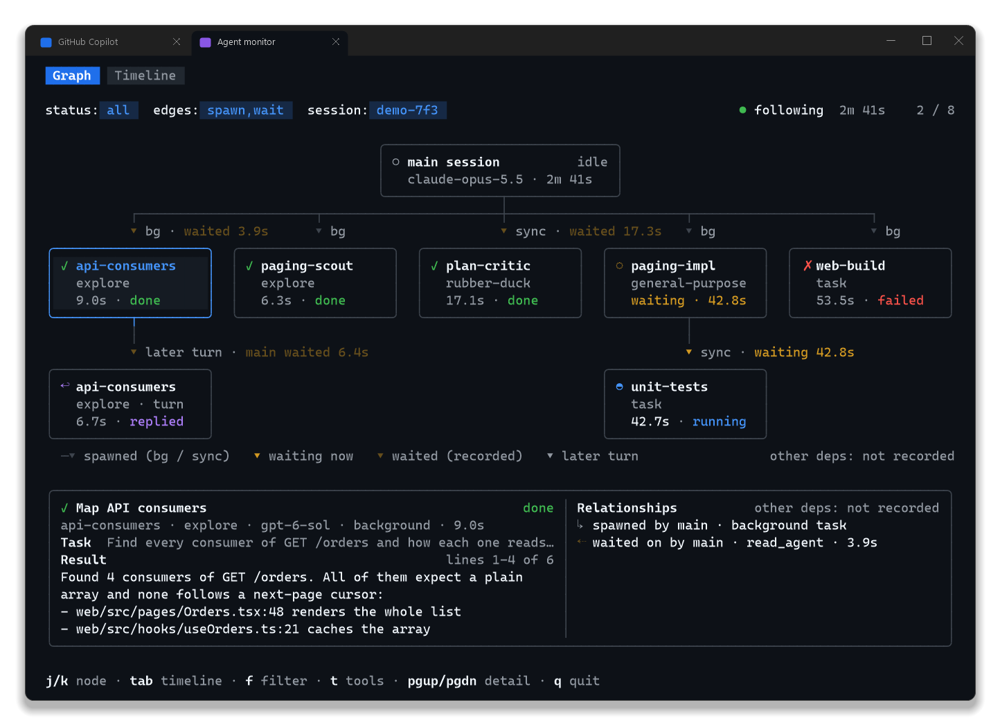
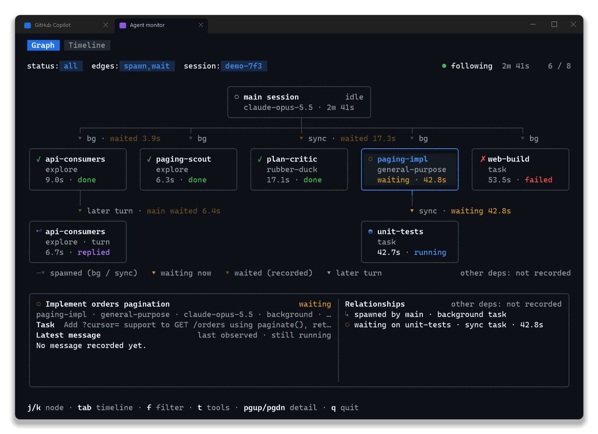
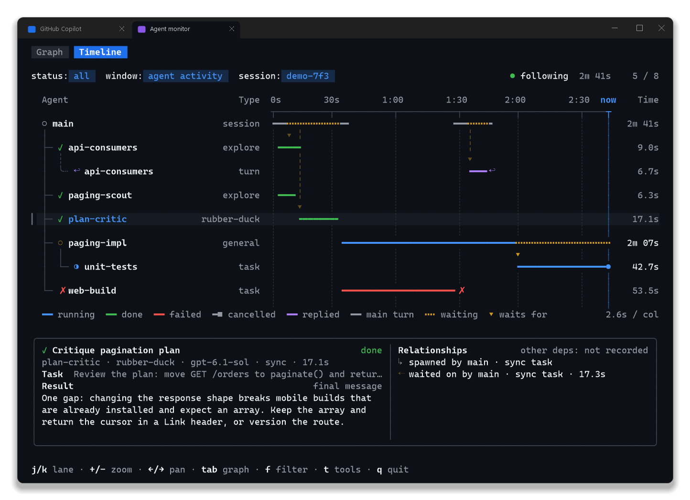

# Agent monitor

Independent, read-only terminal viewer for **one explicitly selected local Copilot
CLI session**. It does not change the built-in `/tasks` interface, load the Copilot
SDK, resume the session, install hooks, call a model, or write to the source log.

## Screenshots

Captured from a fictional demo session (synthetic events, no real transcript).







## Run on Windows

Requires Node.js 22 or later. In PowerShell:

```powershell
Set-Location "<checkout>\tools\agent-monitor"
npm ci
npm run build
$session = Join-Path $env:USERPROFILE ".copilot\session-state\<session-id>"
node .\dist\cli.js --session $session
```

Run this in a **separate interactive terminal tab** alongside Copilot. The viewer
replays the selected directory's `events.jsonl`, then follows newly appended
records. The directory can also belong to a historical session. There is no
automatic scan of other sessions.

For development, use `npm start -- --session "<absolute-session-directory>"`.
Use `node .\dist\cli.js --help` for command-line help. Add `--theme <mode>` to
match the Copilot CLI `/theme` color mode: `default`, `light`, `dim`,
`high-contrast`, or `colorblind` (Primer semantic colors; needs a truecolor
terminal such as Windows Terminal). Minimum size: 80×24.

## Views and keys

The layout follows Copilot CLI's own interface: a tab bar, blue query chips, a
`·`-separated key-hint footer, and a bordered detail dialog. Two views share
one selection:

- **Graph** (default): a spawn tree. The main session sits on top; agents sit
  under the agent or session that launched them, and a reused agent's later
  turns sit side by side under its first turn. Edge labels show `bg` / `sync`
  and any recorded wait with its duration (yellow while waiting, dim once
  finished), naming the waiter when it is not the edge's parent. Cards narrow
  to fit a wide fan-out; beyond that the graph scrolls horizontally to keep
  the selection visible.
- **Timeline**: one swimlane per execution, with the main session's model
  turns on the first lane. Bars are colored by outcome, `╍` marks time spent
  waiting, `▾` connects a waiting lane to the execution it waited for, and the
  `now` cursor follows the session. The default window covers the period in
  which agents ran.

The bottom dialog shows what the selected execution was asked (its task
prompt), its final message or error (the latest message while it runs), and its
recorded relationships. Tool calls stay hidden unless you press `t`. Long text
is loaded from the selected log on demand rather than copied to a new database.

| Key | Action |
| --- | --- |
| Up/Down or `k`/`j` | Select the previous/next execution |
| `g` / `G` | Select the first/last execution |
| Left/Right or `h`/`l` | Graph: previous/next sibling. Timeline: pan earlier/later |
| `+` / `-` | Timeline: zoom in/out (beyond the agent window up to the whole session) |
| Tab | Switch between Graph and Timeline |
| `f` | Cycle all, active, finished; ancestors remain as dimmed context |
| `t` | Show tool calls in the detail dialog instead of relationships (below 100 columns: instead of the message) |
| Page Up / Page Down | Scroll the selected result |
| `q` or Escape | Quit and restore the previous terminal screen |

`done` means an invocation has a recorded `subagent.completed` event or an
accepted agent-attributed `session.task_complete`. `cancelled` means
`subagent.completed` recorded `cancelled: true` (for example, a superseded run);
it is not a failure. `replied` means the agent's latest model turn ended with a
final answer, not progress commentary, but lifecycle completion was not
recorded. Lifecycle events name an agent's original launch call; they settle
the agent's open execution and never overwrite an earlier recorded outcome.
Follow-up executions on a reused agent remain separate from its earlier work.
The finished filter includes replied executions without claiming the agent was
terminated. Running/unknown states are **last observed**, not a process-health
check; silence or end-of-file does not prove that an agent is dead or finished.

## Relationships and compatibility

Initial compatibility was verified against Copilot CLI **1.0.104**, using a local
parallel/nested-agent trace and a same-agent follow-up. The on-disk event format
is version-sensitive, not a supported stable public attachment API. Other CLI
versions display a compatibility warning; malformed or unsupported relevant
records produce explicit diagnostics rather than fabricated results.

- Invocation parents use verified launch-call ownership or
  `subagent.started.data.parentId`. Envelope `parentId` is the event chain and
  is never interpreted as an agent edge.
- Temporary waits use synchronous invocation or explicit `read_agent`
  `wait: true` data. A nonblocking status read is not a dependency.
- The verified format has no general prerequisite/`depends_on` DAG. Its absence
  is displayed explicitly. No graph edges are inferred from timing or prose.
- Background launch acknowledgement is not task completion.
- Missing outputs stay unavailable. Original text may already have been
  truncated by Copilot; the viewer cannot reconstruct it.
- Ephemeral events and unrecorded cancellation/liveness signals cannot be
  recovered from this file. Unknown agent-event types are diagnosed, not
  interpreted as an outcome.
- Detected source replacement/truncation rebuilds the view. A trailing record
  without a newline remains buffered until it is complete. Reading stops on a source
  error, with a visible diagnostic and a nonzero exit status on quit; the clock
  then stays at the last recorded event.
- While following a live log, open executions extend to the current time. A
  recorded `session.shutdown` switches the header to `ended` and stops the clock;
  a later `session.resume` makes the session live again.
- Below 100 columns the detail dialog uses one column and omits relationships.

Text from the log is rendered without terminal control sequences. Session
content stays local: do not copy private transcripts into this repository.
This private package is a standalone local tool, not a modified distribution
of Copilot CLI or a claim that upstream accepts core CLI changes here.

## Validate

```powershell
npm run typecheck
npm test
npm run build
```

Tests use synthetic records and temporary files, covering replay/tailing,
UTF-8 boundaries, source reset, agent/result attribution, lifecycle routing and
cancellation, session resume, recorded wait history, reused agents and later
turns, graph layout and scrolling, the Graph/Timeline views, filtering,
hidden-by-default tool calls, narrow terminals, and result scrolling.
